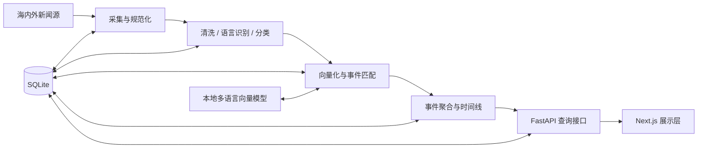

# 系统架构

## 1. 目标与边界

“智览时政”的目标是把来自不同媒体、不同语言的报道组织成可追踪的新闻事件，并支持多视角对照与来源追溯。

当前阶段已经完成新闻信源配置、真实网络验证、RSS/Atom 采集、标准化、SQLite 持久化、定时/手动采集和基础查询。以下能力仍属于后续阶段：

- 正文清洗、语言识别和新闻分类
- 多语言向量表示与跨媒体同一事件识别
- 事件聚合、时间线与多媒体报道对照
- 高级来源关系、转载网络和内容指纹分析

当前代码包含可用的移动端新闻展示、信源管理、采集 API 和 SQLite 数据表。

## 2. 总体架构

系统采用前后端分离结构：

- 前端只通过版本化 HTTP API 获取数据，不直接访问数据库或模型。
- 后端统一负责数据采集、清洗、分析、持久化和对外查询。
- SQLite 是初期唯一持久化存储，后续如出现并发或数据规模瓶颈，再评估迁移方案。
- 多语言向量模型在本地运行，不把新闻正文发送给第三方推理服务。

## 3. 模块职责

### 3.1 前端展示层

目录：`frontend/`

职责：

- 提供新闻事件列表、事件详情、多媒体报道对照和来源追溯界面。
- 维护加载、空状态、错误状态和无障碍交互。
- 按 `docs/api.md` 的约定调用后端接口。
- 不在浏览器端保存真实密钥。

当前状态：已实现手机尺寸新闻首页、关注、详情和独立信源管理页。桌面端只提供 `393 × 852` 手机预览容器。

### 3.2 API 层

目录：`backend/app/api/`

职责：

- 暴露 `/api/v1` 下的查询接口。
- 完成请求参数校验、响应序列化、分页和错误映射。
- 通过服务层获取数据，不在路由中实现采集或匹配逻辑。
- 生成 OpenAPI 文档。

当前状态：已实现健康检查、来源列表/状态、来源验证、手动采集、暂停/恢复、全量采集、采集日志和新闻列表。

### 3.3 采集与规范化

目录：`backend/app/services/`

职责：

- 从已配置新闻源拉取列表和正文。
- 统一标题、正文、作者、发布时间、语言、媒体和原始链接等字段。
- 为每条原始报道生成稳定的内部标识。
- 保留采集时间、原始响应摘要和来源信息，以支持追溯。

约束：

- 采集器必须遵守目标站点条款、robots 约定和访问频率限制。
- 凭据只从环境变量读取。
- 原始抓取结果与清洗结果应可以区分。

### 3.4 文本处理与分类

目录：`backend/app/services/`（规划）

职责：

- 正文抽取、空白清理、重复正文检测。
- 语言识别、分词或句段处理。
- 主题分类与必要的实体、时间、地点提取。
- 产出可追溯的处理版本信息，便于后续重跑。

约束：

- 文本处理函数应保持纯函数优先，便于单元测试。
- 模型或规则版本需要记录，避免结果无法解释。

### 3.5 语义匹配与事件识别

目录：`backend/app/services/`（规划）

职责：

- 使用本地开源多语言向量模型生成报道向量。
- 结合相似度、时间窗口、实体和规则判断跨媒体报道是否指向同一事件。
- 输出候选匹配、置信度和判定依据。
- 支持人工复核与阈值调整。

约束：

- 模型加载与推理通过独立接口封装，避免业务代码绑定具体模型。
- 向量模型文件不提交到 Git。
- 初始版本优先保证可解释性和可复现性，再优化准确率。

### 3.6 事件聚合

目录：`backend/app/services/`（规划）

职责：

- 将同一事件的报道归并为事件。
- 维护事件摘要、时间线、涉及的媒体和报道数量。
- 支持不同媒体对同一事件的表述差异和多媒体内容对照。
- 为前端提供稳定的分页查询结果。

### 3.7 来源追溯

目录：`backend/app/services/`、`backend/app/models/news.py`

职责：

- 记录原始 URL、媒体、作者、发布时间、采集时间和内容指纹。
- 保留转载、引用或近似文本之间的关系。
- 在事件与报道中返回可核验的来源链路。

当前已经保存原始 URL、来源、发布时间、采集时间和采集方式。更复杂的转载网络和内容指纹关系仍待后续阶段。

### 3.8 持久化层

目录：`backend/app/db/`、`backend/app/models/`

职责：

- 管理 SQLite 连接和事务边界。
- 保存新闻源、原始报道、处理后报道、向量元数据、事件、事件成员关系、分类和追溯信息。
- 通过迁移工具管理表结构演进。

当前已建立 `news_sources`、`news`、`collection_logs` 和 `source_validations` 四张表。SQLite 文件放在 `data/`，不得提交到版本库。

### 3.9 测试层

目录：`tests/`

职责：

- `tests/backend/`：API、服务、数据访问和算法单元测试。
- `tests/frontend/`：组件与关键交互测试。
- 测试夹具不得包含真实密钥或未脱敏的受限新闻正文。

当前状态：包含健康检查、来源目录、RSS/Atom 解析、采集去重、暂停恢复、API 和前端交互测试。

## 4. 核心数据概念

后续实现时至少需要区分以下概念：

| 概念           | 含义                                   |
| -------------- | -------------------------------------- |
| Source         | 新闻媒体或采集来源                     |
| Report         | 一条具体报道及其原始来源信息           |
| Event          | 被识别为同一新闻事件的报道集合         |
| Classification | 报道或事件的主题分类及版本             |
| Embedding      | 报道文本对应的向量及模型版本           |
| Provenance     | 原始链接、采集时间、内容指纹和引用关系 |
| Coverage       | 不同媒体对同一事件的报道与多媒体内容   |

其中 Source、Report（当前实现为 `news` 表）、Provenance 基础字段和 Collection Log 已经建立数据库结构；Event、Classification、Embedding 和 Coverage 仍待后续阶段。

## 5. 关键设计原则

1. **事件与报道分离**：事件是聚合结果，报道是来源事实，不能混成一个对象。
2. **来源可追溯**：任何聚合摘要都应能回到具体报道与原始链接。
3. **模型可替换**：向量模型通过适配层接入，业务逻辑不直接依赖模型库 API。
4. **结果可复现**：记录清洗、分类、模型和匹配阈值版本。
5. **接口先约定**：前后端通过 `/api/v1` 契约协作，接口变更需要同步文档。
6. **本地数据不入库**：数据库、模型文件、日志和抓取缓存均由 `.gitignore` 排除。

## 6. 安全与合规

- 密钥、令牌和 Cookie 只放在本地 `.env` 或部署环境变量中。
- `.env.example` 只提供变量名和非敏感占位值。
- 当前信源管理写接口没有用户鉴权，不得直接暴露到公网；正式部署前必须增加访问控制。
- 采集频率、版权和站点条款需在接入每个来源前确认。
- 对新闻正文只做本地模型推理，避免未经授权的数据外传。
- 日志不得输出完整密钥、认证头和受限正文。

## 7. 推荐演进顺序

1. 在正式部署网络复验来源并完成版权/条款审核。
2. 为符合条件的普通网页来源编写受控适配器。
3. 建立分类与多语言向量基线。
4. 建立事件候选匹配、聚类和人工复核流程。
5. 完善多媒体报道对照、完整来源追溯和稳定公网部署。
6. 补充迁移工具、性能、可观测性、备份和鉴权。
